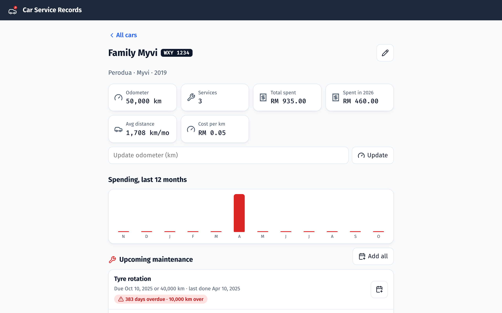

# Car Service Records

Mobile-first, installable web app (PWA) for tracking car maintenance. No server, no build step, no API keys. Data stays on the device in a **SQLite** database.



## Features
- **Multiple cars**: nickname, plate, make/model/year, odometer.
- **Service records**: snap or pick photos of the bill (camera opens on phones), mark the service date and odometer, and list the services with costs.
- **Google Maps**: each record shows the workshop on an embedded map plus an "Open in Google Maps" link. Type an address, or tap 📍 to use your current location.
- **Dashboards**: totals across all cars on the home screen. Per car: odometer, total and yearly spend, average km/month, cost per km, a 12-month spending chart, and the service history.
- **Maintenance suggestions**: for every service type a car has history for, the next due date and km are worked out from standard intervals (`SERVICE_TYPES` in `schedule.js`), whichever comes first. Due dates are pulled earlier using the car's real km/day trend. Items are marked ok / soon (≤30 days or ≤1,000 km) / overdue.
- **Reminders**:
  - 📅 adds a reminder to the phone calendar (`.ics` file, alerts 1 day before). This is the reliable option because it works when the app is closed.
  - 🔔 shows a notification for due items once a day, when the app is opened.
- **Backup / restore** as a JSON file, photos included, plus **Export SQLite** (open it in DB Browser for SQLite or the `sqlite3` CLI).
- **Installable PWA**: works offline, with PNG + maskable icons, store screenshots, an "Add service" shortcut and an in-app Install button (on iPhone: Share, then Add to Home Screen).

## Database (SQL)
The app uses the official SQLite WebAssembly build (`vendor/sqlite`), run in a Web Worker (`db-worker.js`) and saved to the browser's Origin Private File System (`opfs-sahpool`, which needs no special server headers). Schema:

```sql
cars    (id PK, name, plate, make, model, year, odometer, odometer_date)
records (id PK, car_id → cars ON DELETE CASCADE, date, odometer, workshop, location, notes)
items   (record_id → records ON DELETE CASCADE, pos, type, note, cost)
photos  (record_id → records ON DELETE CASCADE, pos, mime, data BLOB)
```
Deleting a car removes its records, items and photos through the cascades. All queries are in `db.js`. Only one tab can have the database open at a time; a second tab shows a "close other tabs" message rather than risk losing data.

## Design
The design system came from the UI UX Pro Max skill (automotive palette): slate `#1E293B` primary, action red `#DC2626` buttons, Fira Sans text with Fira Code numbers, Lucide SVG icons, 44px touch targets, visible focus, light and dark themes, and reduced motion when the phone asks for it. Fonts and icons are self-hosted so the app works offline.

## Run
```sh
npm start        # or: python3 -m http.server 8080
npm test         # scheduling logic tests (Node 20+)
```
Open http://localhost:8080. Camera, location and notifications need HTTPS or localhost. To use it on a phone, host the folder on any static HTTPS host (GitHub Pages, Netlify), open it and choose "Add to Home Screen".

## Files
| File | Purpose |
|---|---|
| `index.html`, `style.css` | Shell and styles (light/dark) |
| `app.js` | Views, routing, forms, photos, maps, reminders, backup |
| `schedule.js` | Maintenance intervals, suggestions, calendar export (unit-tested) |
| `db.js`, `db-worker.js` | SQLite schema and queries |
| `icons.js` | Lucide icons (ISC) |
| `sw.js`, `manifest.webmanifest`, `icons/`, `screenshots/` | Offline support and installability |
| `vendor/` | SQLite WASM 3.50.4 (public domain), Fira fonts (OFL) |
